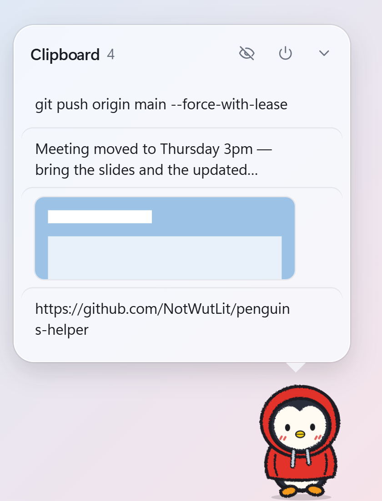

# Penguin's Helper

A small penguin in a red hoodie that lives in the bottom-right corner of your Windows desktop and holds onto things you copy.


## Features

- **Clipboard keeper.** Click the penguin, press <kbd>Ctrl</kbd>+<kbd>V</kbd>, and whatever you copied (text, or an image like a <kbd>Win</kbd>+<kbd>Shift</kbd>+<kbd>S</kbd> screenshot) is added to its list. Click an entry to copy it back. Hover and click the trash icon to delete it.
- **Keeps you company.** Every 9 to 18 seconds it picks something to do: reading a book, coding on a laptop, playing chess, or just rocking and blinking.
- **Gets out of the way.** The crossed-out eye in the panel sends the penguin waddling off the screen. A small red tab with one eye stays at the screen edge. Click it and the penguin walks back.
- **Click-through.** Only the penguin and its panel catch the mouse. Everything around them passes clicks to the windows behind.



## Download

Get the latest version from the **[Releases page](https://github.com/NotWutLit/penguins-helper/releases/latest)** (Windows 10 or 11):

- **`Penguins-Helper-Setup-x.y.z.exe`**: installs the app for your user (no admin needed), adds it to the Start menu, and starts it with Windows. Uninstall from Settings → Apps.
- **`Penguins-Helper-x.y.z-portable.exe`**: no install, just run it.

The app isn't code-signed, so Windows SmartScreen may say it "protected your PC". Click **More info → Run anyway**.

Once it's running, the penguin lives in the bottom-right corner and has an icon in the system tray (it may be under the **^** arrow). Right-click the tray icon to show or hide the penguin, turn **Start with Windows** on or off, or quit.

## Run from source

You need [Node.js](https://nodejs.org/) 18 or newer.

```
git clone https://github.com/NotWutLit/penguins-helper.git
cd penguins-helper
npm install
npm start          # run it
npm test           # run the tests
npm run dist       # build the installer and portable exe into dist/
```

## Using it

| To | Do this |
|---|---|
| Open or close the clipboard | Click the penguin |
| Add what you copied | Click the penguin, then press <kbd>Ctrl</kbd>+<kbd>V</kbd> |
| Copy an entry back | Click the entry |
| Delete an entry | Hover it, click the trash icon |
| Hide the penguin | Open the panel, click the crossed-out eye |
| Bring it back | Click the red tab at the right screen edge |
| Bring it back from the tray | Click the tray icon |
| Start with Windows on or off | Right-click the tray icon |
| Quit | Open the panel and click the power icon, or right-click the tray icon |

## Privacy

The clipboard list lives in memory only. It is never written to disk, starts empty every launch, and the app makes no network requests. The penguin only sees what you paste into it while its window has focus.

## Safe with anti-cheat

Penguin's Helper is built to stay out of trouble with kernel anti-cheat such as Riot Vanguard. It uses no native modules, no global hotkeys or keyboard/mouse hooks, no simulated input, no screen capture, and never touches other processes. It is a plain Electron window, the same runtime Discord and VS Code use. Contributions must keep it that way.

## Project layout

| File | What it does |
|---|---|
| `main.js` | Electron main process: the always-on-top window, click-through, tray icon, start with Windows, clipboard reads and writes |
| `preload.js` | The small API the page can call (`window.penguin`) |
| `index.html` | The penguin (inline SVG), its animations, and the clipboard panel |
| `history.js` | Adds entries to the clipboard list (newest first, no duplicates, capped at 50) |
| `test.js` | Tests for `history.js`, run with `npm test` |
| `build/` | App and tray icon |

## Credits

The penguin is based on a hoodie-penguin drawing the author painted on a tote bag.

## License

[MIT](LICENSE)
